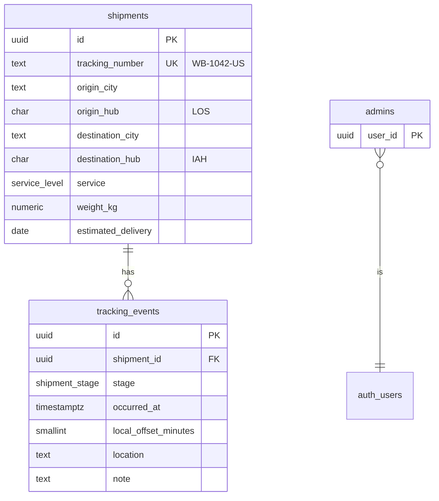

# Waybill

Shipment tracking and payments for cross-border logistics between Nigeria, the US, the UK and Canada.

I built Waybill as a portfolio project, drawing on how we run operations at eShopAfrica, an international logistics company in Lagos. Customers there ask one question more than any other: _where is my package?_ Waybill answers it, and over the next stages it grows into the full flow: booking, quoting, admin tools and paying with Paystack.

**Live demo:** [waybill-dusky.vercel.app](https://waybill-dusky.vercel.app)
**Status:** Stage 5 of 6 complete. Customers price, book and pay online with Paystack (test mode); staff turn paid bookings into tracked shipments. All data and prices are invented.


## Try it

Run the project without a database and these sample tracking numbers work, each at a different stage of its journey. The live demo uses only real bookings, so to see tracking there, book a shipment and pay with a Paystack test card.

| Tracking number | Route               | Stage            |
| --------------- | ------------------- | ---------------- |
| `WB-6604-UK`    | Abuja to Manchester | Booked           |
| `WB-5310-US`    | Lagos to Atlanta    | Picked up        |
| `WB-3150-CA`    | Lagos to Toronto    | In transit       |
| `WB-2087-NG`    | London to Lagos     | At customs       |
| `WB-4021-NG`    | Houston to Lagos    | Out for delivery |
| `WB-1042-US`    | Lagos to Houston    | Delivered        |

You can type the number the way customers really do: `wb 1042 us` and `WB1042US` both work.

To price a shipment, open [`/quote`](https://waybill-dusky.vercel.app/quote). For example, 2.2 kg by Air Express from Lagos to the UK comes to ₦52,406.25 including VAT.

## What Stage 1 includes

- **Tracking search** that accepts messy input, explains mistakes in plain language and sends you to one canonical URL per shipment.
- **A tracking result designed like a printed waybill:** big hub codes for the route, a six-step progress bar, the shipment facts in ruled boxes, and a full scan history with times shown in the local time of each scan.
- **A helpful not-found page** with the correct number format and sample numbers.
- **Mobile first.** Most of our customers track on mid-range Android phones, so every screen is designed for 360px first.
- **Accessible:** a skip link, labelled form fields, errors announced to screen readers, a real `progressbar` with readable values and `aria-current` on the active step.

## What Stage 2 adds

- **A real database.** Shipments and their scans live in Supabase (PostgreSQL), defined in a versioned migration in [`supabase/migrations`](supabase/migrations).
- **Row Level Security that blocks enumeration.** The public cannot read any table. The only public read path is one database function, `get_shipment(tracking_number)`, which returns a single shipment for an exact tracking number. Nobody can list shipments or page through them.
- **Admin sign in** at `/admin/login` with Supabase Auth. Signed-out visitors are redirected by the proxy, and the server checks admin access against the database again before showing anything.
- **An admin shipment list** at `/admin`, with the status, route and number of scans for every shipment. Creating and editing shipments arrives in Stage 3.
- **Times stay local.** Scans are stored as UTC plus the offset of the place they happened, so "2:47 pm Houston time" survives the round trip.

### Data model



### Who can do what

| Who                     | shipments / tracking_events                                           | admins       | get_shipment() |
| ----------------------- | --------------------------------------------------------------------- | ------------ | -------------- |
| Public (anon)           | No access                                                             | No access    | Yes            |
| Signed in, not an admin | No rows returned, writes rejected                                     | Own row only | Yes            |
| Admin                   | Read, create and update; remove the latest scan; cancel, never delete | Own row only | Yes            |

Admins are added with SQL only, so there is no API an attacker could use to make themselves one. `is_admin()` and `get_shipment()` are `security definer` functions with a locked `search_path`, and tables are not exposed to the Data API unless a grant says so.

## What Stage 5 adds

- **Pay online with Paystack.** After booking, the customer pays on Paystack's checkout by card, bank transfer or USSD. The demo runs in Paystack **test mode**, so only test cards work and no real money moves.
- **A payment page per booking** at `/pay/[reference]`, which shows the total and the payment status. It shows no names, phone numbers or addresses.
- **Payments in the admin dashboard.** Each booking lists its payment attempts, and paid bookings are marked so staff know which to ship.

### How a payment is confirmed

```mermaid
sequenceDiagram
  participant C as Customer
  participant W as Waybill server
  participant P as Paystack
  participant D as Database
  C->>W: Pay for BK-7KQ4MX
  W->>D: Load booking (server key)
  W->>W: Recompute the price from the rate card
  W->>D: Record attempt BK-7KQ4MX-<random> for the exact amount
  W->>P: Initialize transaction
  W-->>C: Redirect to Paystack checkout
  C->>P: Pay
  P-->>C: Redirect back with ?reference=...
  C->>W: /pay/BK-7KQ4MX/callback
  W->>P: Verify transaction (secret key)
  W->>D: Record result; amount and currency must match
  P->>W: Webhook charge.success (signed)
  W->>W: Check HMAC-SHA512 signature
  W->>P: Verify again
  W->>D: Record result (already paid: no change)
```

- **The browser is never trusted.** The amount comes from the rate card, applied to the booking stored in the database. If that no longer matches what the customer was shown, Waybill refuses to charge rather than charge a different amount.
- **Every result is verified with Paystack's API** using the secret key. The `?reference=` in the redirect only tells Waybill which transaction to ask about.
- **The webhook checks Paystack's signature** (an HMAC-SHA512 of the raw body) before doing anything. It then verifies with the API anyway, so a payment counts even if the customer closes the tab before coming back.
- **Recording is idempotent.** The redirect and the webhook usually both arrive, and the second one changes nothing.
- **The server key.** The app reaches the database with the public key, so the payment functions also demand a server key that only Vercel holds. The database keeps just its SHA-256 hash, in a schema the Data API cannot reach. Without it, nobody can read a customer's email or mark a booking as paid.
- **Refunds are tracked, not lost.** If money arrives for a booking that no longer wants it (declined, already paid, or a checkout tab left open) or a paid shipment is cancelled, the payment is kept and flagged **Refund needed** in the dashboard until staff mark it refunded.
- **Declined cards are reported.** Paystack only notifies on success, so when a booking page loads with an attempt still open, Waybill asks Paystack what happened and tells the customer their card was declined.
- [`supabase/tests/payments.sql`](supabase/tests/payments.sql) and [`supabase/tests/refunds.sql`](supabase/tests/refunds.sql) check these rules against a live database and undo every change.

## What Stage 4 adds

- **A quote calculator** at `/quote`. Pick the service, where it ships from and to, the weight and, optionally, the box size. The price and its breakdown update as you type.
- **A booking form** at `/book`, prefilled from the quote. It collects the sender, receiver and package details and returns a booking reference.
- **Bookings in the admin dashboard.** Staff review each booking, then create the shipment from it in one step (tracking number and first scan included) or decline it with a reason.

### How prices work

| Rule                          | Detail                                                                                                                                                                                   |
| ----------------------------- | ---------------------------------------------------------------------------------------------------------------------------------------------------------------------------------------- |
| Per kilo, everything in naira | Air and sea alike, so Paystack can charge every booking (Stage 5)                                                                                                                        |
| Zones                         | UK and Ireland, Europe, US and Canada, Africa, Asia, rest of world. Each country's zone comes from its main time zone region, so all 240+ countries are covered without a hand-kept list |
| Chargeable weight             | The bigger of the real weight and the box size (cm³ / 5,000 for air, / 6,000 for sea), rounded up to the next half kilo. Minimum 1 kg by air, 10 kg by sea                               |
| Getting it to us              | Free drop-off at the Lagos office in Ojota (or the Guangzhou warehouse), or pickup for a fee                                                                                             |
| Extras                        | Handling fee, then 7.5% VAT on the total                                                                                                                                                 |

The rate card lives in [`src/lib/pricing/rate-card.ts`](src/lib/pricing/rate-card.ts) and its numbers are made up for this demo. `calculateQuote()` is a pure function: the browser runs it to show the price live, and the server runs it again before saving. The server never takes a price from the browser, and the admin page recomputes every booking and flags any that do not match.

### Keeping bookings safe

- The public creates bookings only through `submit_booking()`, a database function that checks every field and allows at most five bookings an hour per email address.
- Bookings hold names, phone numbers and addresses, so only admins can read them. Admins can move a booking on but cannot rewrite what the customer sent.
- The form has a hidden honeypot field and rejects submissions sent back faster than a person could fill it in.
- [`supabase/tests/bookings.sql`](supabase/tests/bookings.sql) checks these rules against a live database and undoes every change.

## What Stage 3 adds

- **An admin dashboard** at `/admin`: every shipment, with search by tracking number, city or hub code, and a filter by status.
- **Create a shipment** at `/admin/shipments/new`. Waybill generates the tracking number (it ends in the destination country, like `WB-4821-NG`) and posts the first Booked scan in the same database transaction.
- **A page per shipment** to post tracking updates, edit the package details, remove a scan posted by mistake, or cancel the shipment.
- **Instant public updates.** Each change calls `updateTag` for that shipment, so the cached tracking page is fresh on the next visit.
- **Real routes.** Air ships from Nigeria or China to any of 240+ countries; sea freight runs from Nigeria to the United States, Canada and the United Kingdom. The forms only offer valid choices, and the server checks again.
- **Local time everywhere.** The admin picks the place of a scan; countries with several time zones (the US, Canada, China...) ask which one. The scan is stored as UTC plus that place's offset on that date, daylight saving included.

### Rules the database enforces

The rules live in Postgres triggers, not just the forms, so they hold for every client: the dashboard, the SQL editor or a script.

| Rule                                                                    | Why                                                                        |
| ----------------------------------------------------------------------- | -------------------------------------------------------------------------- |
| Stages only move forward; in transit and at customs may repeat          | A parcel can pass several hubs, but never goes from customs back to pickup |
| Scans are in time order and not in the future                           | The timeline a customer reads must make sense                              |
| Delivered and cancelled shipments take no new scans                     | Their story is finished                                                    |
| Scans cannot be edited; only the latest can be removed, never the first | Mistakes are undone without rewriting history                              |
| The route, service and tracking number are fixed after booking          | Customers may already have the number                                      |
| Shipments are cancelled, never deleted                                  | There is always a record                                                   |

Rule violations raise a plain-English message with SQLSTATE `P0001`, which the dashboard shows as it is. [`supabase/tests/rules.sql`](supabase/tests/rules.sql) checks all of them against a live database and undoes every change.

## Tech stack

| Area      | Choice                                                       |
| --------- | ------------------------------------------------------------ |
| Framework | Next.js 16 (App Router, Server Components, Cache Components) |
| Database  | Supabase: PostgreSQL, Row Level Security, Auth               |
| Language  | TypeScript, strict mode                                      |
| Styling   | Tailwind CSS 4, self-hosted IBM Plex fonts                   |
| Testing   | Vitest and React Testing Library                             |
| Quality   | ESLint, Prettier, GitHub Actions CI                          |
| Hosting   | Vercel                                                       |

Tracking pages are cached with `use cache` for a few minutes and tagged per shipment, so Stage 3 can refresh one page the moment an admin posts a scan.

## Run it locally

You need Node.js 22 or later.

```bash
git clone https://github.com/Oretugaadewale/waybill.git
cd waybill
npm install
npm run dev
```

Then open http://localhost:3000. Without Supabase settings the app runs on the bundled sample data, which is also what CI uses.

### Connect Supabase (optional)

1. Create a Supabase project.
2. In the SQL Editor, run the files in [`supabase/migrations`](supabase/migrations) in order, then [`supabase/seed.sql`](supabase/seed.sql).
3. Copy `.env.example` to `.env.local` and fill in the Project URL and publishable key from **Project Settings > API**.
4. Create a user in **Authentication > Users**, then make it an admin:

   ```sql
   insert into public.admins (user_id)
   select id from auth.users where email = 'you@example.com';
   ```

To take payments, also:

5. Add `PAYSTACK_SECRET_KEY` (your `sk_test_...` key) to `.env.local` or your host's environment.
6. In the SQL Editor run `select public.create_server_key();` once and store the result as `WAYBILL_SERVER_KEY`. Only its hash is kept in the database.
7. In Paystack, under **Settings > API Keys & Webhooks**, set the **test** webhook URL to `https://<your-domain>/api/paystack/webhook`.

`npm run db:seed-sql` regenerates `seed.sql` from the sample data, so the database and the offline fallback never drift apart.

| Command                 | What it does                                 |
| ----------------------- | -------------------------------------------- |
| `npm run dev`           | Start the development server                 |
| `npm test`              | Run the unit and component tests             |
| `npm run test:e2e`      | Run the end-to-end tests on the sample data  |
| `npm run test:e2e:live` | Run the read-only checks on the deployed app |
| `npm run lint`          | Lint the code                                |
| `npm run typecheck`     | Type check the whole project                 |
| `npm run build`         | Build for production                         |

Every push to `main` runs formatting, lint, type checks, unit tests, a production build and the end-to-end tests in CI.

### End-to-end tests

The browser tests use [Playwright](https://playwright.dev) and live in [`e2e`](e2e). They run in two modes.

- **Sample data** (`e2e/sample`, on every push). The production build runs with no database, on desktop and phone screen sizes. The tests cover tracking (including messy input like `wb 2087 ng`), every sample shipment, the quote rules (rounding up, the sea minimum, volumetric weight, the pickup fee), the booking form's errors and its bot check, and the not-found pages. Any uncaught error in the page fails the test. That is how these tests found a hydration bug: Node and Chrome name some countries differently.
- **Live** (`e2e/live`, after each deploy and every morning). Read-only checks on the deployed site. They check that payments are set up in Paystack **test** mode, that a real shipment tracks, that the server rejects an incomplete booking, that a paid booking can't be paid twice, that the admin area needs a sign-in, and that the webhook rejects unsigned requests.

The full journey (quote, book, pay on Paystack's test checkout, land on the paid page) saves a real booking. It only runs when the **Live checks** workflow is started by hand with **allow_writes** ticked, or locally with `E2E_ALLOW_WRITES=1`.

```bash
npx playwright install chromium   # once
npm run build && npm run test:e2e
```

## Project structure

```
src/
  app/                    Routes: home, /track/[trackingNumber], not-found pages
  components/             UI components and their tests
  app/admin/              Admin sign in, dashboard, new shipment and shipment pages
  lib/admin/              Admin session checks, form state and data mapping
  lib/shipments/          Shipment types, sample data, tracking logic, route rules and form validation
  lib/places.ts           Countries, time zones and local time conversion
  lib/pricing/            Rate card, zones and the quote calculator
  lib/bookings/           Booking validation and admin helpers
  app/quote, app/book     Public quote calculator and booking form
  app/pay, app/api        Payment page, Paystack callback and webhook
  lib/payments/           Paystack client, signature check and payment confirmation
  lib/supabase/           Supabase clients for the signed-in user and the public
  fonts/                  Self-hosted IBM Plex Sans and Mono
  proxy.ts                Refreshes the session and guards /admin
supabase/
  migrations/             Schema, grants, Row Level Security and the tracking rules
  tests/                  SQL checks for the tracking, booking and payment rules
  seed.sql                The six sample shipments
```

The tracking logic, route rules and time zone handling are plain TypeScript with no framework code, so they are easy to test. The forms and the database apply the same rules: the forms for clear messages, the database so nothing can get around them.

## Roadmap

| Stage | Scope                                                              | Status                      |
| ----- | ------------------------------------------------------------------ | --------------------------- |
| 1     | Project setup and public tracking page                             | Done                        |
| 2     | Supabase database, Row Level Security and admin login              | Done                        |
| 3     | Admin dashboard to create shipments and post tracking updates      | Done                        |
| 4     | Booking form and a quote calculator by weight, route and service   | Done                        |
| 5     | Paystack test payments with server-side verification and a webhook | Done                        |
| 6     | End-to-end tests, final deploy and a write-up of the decisions     | Partly done: tests in place |

## About

Built by [Adewale Oretuga](https://adewale-oretuga.netlify.app), a frontend engineer in Lagos working with React, Next.js and TypeScript. All shipments, names and tracking numbers in this project are invented.

## Licence

[MIT](LICENSE)
