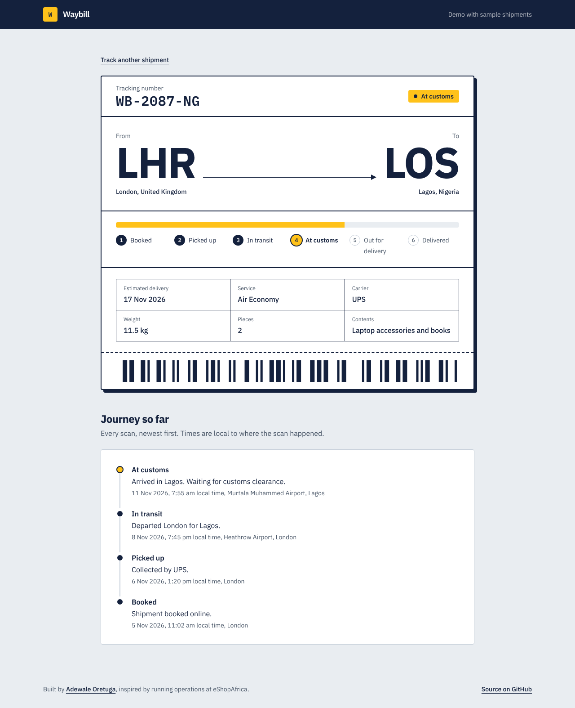
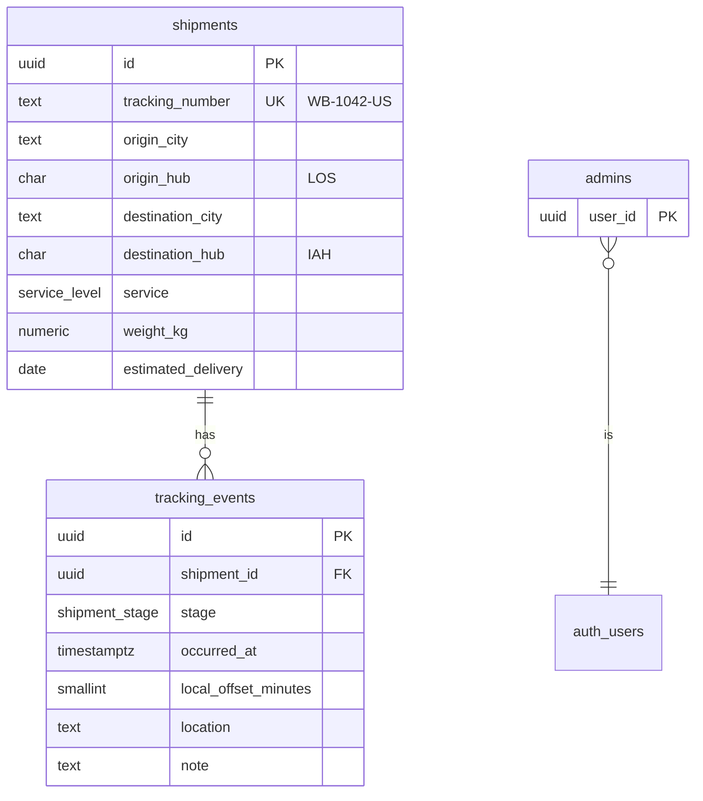

# Waybill

Shipment tracking and payments for cross-border logistics between Nigeria, the US, the UK and Canada.

I built Waybill as a portfolio project, drawing on how we run operations at eShopAfrica, an international logistics company in Lagos. Customers there ask one question more than any other: _where is my package?_ Waybill answers it, and over the next stages it grows into the full flow: booking, quoting, admin tools and paying with Paystack.

**Live demo:** [waybill-dusky.vercel.app](https://waybill-dusky.vercel.app)
**Status:** Stage 2 of 6 complete. Shipments live in Supabase, behind Row Level Security, with an admin login. All data is invented.



## Try it

Open the demo and enter any of these sample tracking numbers. Each one is at a different stage of its journey.

| Tracking number | Route               | Stage            |
| --------------- | ------------------- | ---------------- |
| `WB-6604-UK`    | Abuja to Manchester | Booked           |
| `WB-5310-US`    | Lagos to Atlanta    | Picked up        |
| `WB-3150-CA`    | Lagos to Toronto    | In transit       |
| `WB-2087-NG`    | London to Lagos     | At customs       |
| `WB-4021-NG`    | Houston to Lagos    | Out for delivery |
| `WB-1042-US`    | Lagos to Houston    | Delivered        |

You can type the number the way customers really do: `wb 1042 us` and `WB1042US` both work.

## What Stage 1 includes

- **Tracking search** that accepts messy input, explains mistakes in plain language and sends you to one canonical URL per shipment.
- **A tracking result designed like a printed waybill:** big hub codes for the route, a six-step progress bar, the shipment facts in ruled boxes, and a full scan history with times shown in the local time of each scan.
- **A helpful not-found page** with the correct number format and sample numbers.
- **Mobile first.** Most of our customers track on mid-range Android phones, so every screen is designed for 360px first.
- **Accessible:** a skip link, labelled form fields, errors announced to screen readers, a real `progressbar` with readable values and `aria-current` on the active step.

## What Stage 2 adds

- **A real database.** Shipments and their scans live in Supabase (PostgreSQL), defined in a versioned migration in [`supabase/migrations`](supabase/migrations).
- **Row Level Security that blocks enumeration.** The public cannot read any table. The only public read path is one database function, `get_shipment(tracking_number)`, which returns a single shipment for an exact tracking number. Nobody can list shipments or page through them.
- **Admin sign in** at `/admin/login` with Supabase Auth. Signed-out visitors are redirected by the proxy, and the server checks admin access against the database again before showing anything.
- **An admin shipment list** at `/admin`, with the status, route and number of scans for every shipment. Creating and editing shipments arrives in Stage 3.
- **Times stay local.** Scans are stored as UTC plus the offset of the place they happened, so "2:47 pm Houston time" survives the round trip.

### Data model



### Who can do what

| Who                     | shipments / tracking_events       | admins       | get_shipment() |
| ----------------------- | --------------------------------- | ------------ | -------------- |
| Public (anon)           | No access                         | No access    | Yes            |
| Signed in, not an admin | No rows returned, writes rejected | Own row only | Yes            |
| Admin                   | Read, create, update, delete      | Own row only | Yes            |

Admins are added with SQL only, so there is no API an attacker could use to make themselves one. `is_admin()` and `get_shipment()` are `security definer` functions with a locked `search_path`, and tables are not exposed to the Data API unless a grant says so.

## Tech stack

| Area      | Choice                                                       |
| --------- | ------------------------------------------------------------ |
| Framework | Next.js 16 (App Router, Server Components, Cache Components) |
| Database  | Supabase: PostgreSQL, Row Level Security, Auth               |
| Language  | TypeScript, strict mode                                      |
| Styling   | Tailwind CSS 4, self-hosted IBM Plex fonts                   |
| Testing   | Vitest and React Testing Library                             |
| Quality   | ESLint, Prettier, GitHub Actions CI                          |
| Hosting   | Vercel                                                       |

Tracking pages are cached with `use cache` for a few minutes and tagged per shipment, so Stage 3 can refresh one page the moment an admin posts a scan.

## Run it locally

You need Node.js 22 or later.

```bash
git clone https://github.com/Oretugaadewale/waybill.git
cd waybill
npm install
npm run dev
```

Then open http://localhost:3000. Without Supabase settings the app runs on the bundled sample data, which is also what CI uses.

### Connect Supabase (optional)

1. Create a Supabase project.
2. In the SQL Editor, run [`supabase/migrations/20261113120000_init.sql`](supabase/migrations/20261113120000_init.sql), then [`supabase/seed.sql`](supabase/seed.sql).
3. Copy `.env.example` to `.env.local` and fill in the Project URL and publishable key from **Project Settings > API**.
4. Create a user in **Authentication > Users**, then make it an admin:

   ```sql
   insert into public.admins (user_id)
   select id from auth.users where email = 'you@example.com';
   ```

`npm run db:seed-sql` regenerates `seed.sql` from the sample data, so the database and the offline fallback never drift apart.

| Command             | What it does                 |
| ------------------- | ---------------------------- |
| `npm run dev`       | Start the development server |
| `npm test`          | Run the test suite           |
| `npm run lint`      | Lint the code                |
| `npm run typecheck` | Type check the whole project |
| `npm run build`     | Build for production         |

Every push to `main` runs formatting, lint, type checks, tests and a production build in CI.

## Project structure

```
src/
  app/                    Routes: home, /track/[trackingNumber], not-found pages
  components/             UI components and their tests
  app/admin/              Admin sign in, sign out and the shipment list
  lib/shipments/          Shipment types, sample data, tracking logic and the repository
  lib/supabase/           Supabase clients for the signed-in user and the public
  proxy.ts                Refreshes the session and guards /admin
supabase/
  migrations/             Schema, grants and Row Level Security policies
  seed.sql                The six sample shipments
  fonts/                  Self-hosted IBM Plex Sans and Mono
```

The tracking logic in `src/lib/shipments/tracking.ts` is plain TypeScript with no framework code, so it is easy to test and will stay the same when the data moves into a database.

## Roadmap

| Stage | Scope                                                              | Status  |
| ----- | ------------------------------------------------------------------ | ------- |
| 1     | Project setup and public tracking page                             | Done    |
| 2     | Supabase database, Row Level Security and admin login              | Done    |
| 3     | Admin dashboard to create shipments and post tracking updates      | Next    |
| 4     | Booking form and a quote calculator by weight, route and service   | Planned |
| 5     | Paystack test payments with server-side verification and a webhook | Planned |
| 6     | End-to-end tests, final deploy and a write-up of the decisions     | Planned |

## About

Built by [Adewale Oretuga](https://adewale-oretuga.netlify.app), a frontend engineer in Lagos working with React, Next.js and TypeScript. All shipments, names and tracking numbers in this project are invented.

## Licence

[MIT](LICENSE)
